# 교통 표지판 이미지 분류: ANN · DNN · CNN 구조 비교

한국 도로 표지판 이미지 10종을 같은 조건의 ANN·DNN·CNN으로 학습하고,
깊이와 파라미터 수가 아니라 파라미터를 배치한 구조가 성능을 가르는지 비교한 실험.
같은 구조를 PyTorch와 Keras로 각각 구현해 결과를 교차 확인.

## 검증 항목
1. 완전연결층을 더 깊게 쌓으면, 즉 ANN에서 DNN으로 가면 정확도가 오르는가
2. 성능을 가르는 것은 파라미터의 양인가, 파라미터를 배치한 구조인가

## 사용 기술

| 도구 | 버전 | 역할 |
|---|---|---|
| Python | 3.11 | 전체 구현 언어 |
| PyTorch | 2.11, CUDA 12.8 | 학습 루프 직접 구현 |
| TensorFlow · Keras | 2.21 | 동일 구조 재구현, 결과 교차 확인 |
| NumPy | 2.4 | 예측값·정답 배열 처리 |
| Matplotlib | 3.11 | 학습곡선·혼동행렬·클래스별 정확도 그림 |
| scikit-learn | 1.9 | 혼동행렬 계산 |
| Pillow | 12.2 | 이미지 크기 확인, 표지판 잘라내기 |
| GPU | NVIDIA RTX 3080 | PyTorch 학습 가속, Keras는 Windows에서 CPU 실행 |

## 데이터
- AI-Hub 신호등·도로표지판 인지 영상 수도권 표지판 crop 데이터, 104개 분류 코드
- 장수 상위 10개 코드 선택, 코드당 1,000장 추출, 짧은 변 24px 미만 이미지 제외: `build_dataset.py`
- 입력: 32×32 RGB

| 코드 | 표지판 | 코드 | 표지판 |
|---|---|---|---|
| 213 | 좌회전금지 | 308 | 좌우회전 |
| 214 | 우회전금지 | 309 | 직진및좌회전 |
| 218 | 주정차금지 | 311 | 유턴 |
| 219 | 주차금지 | 322 | 횡단보도 |
| 221 | 차높이제한 | 329 | 비보호좌회전 |

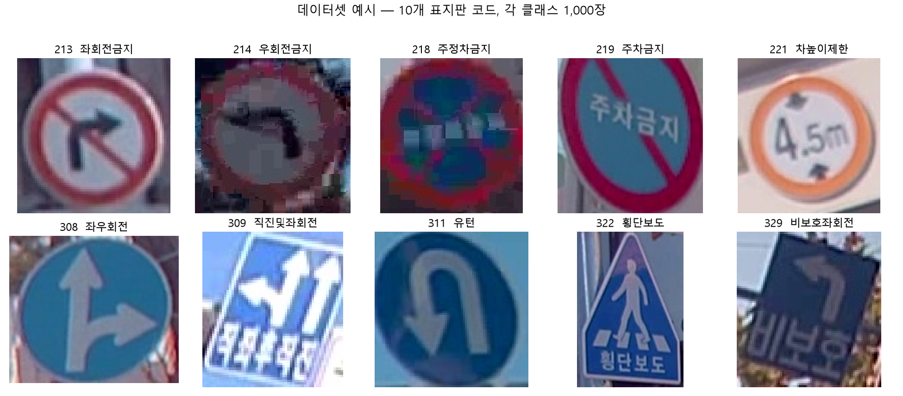

### 데이터셋 구성 절차: `build_dataset.py`
1. `표지판코드분류crop데이터*/…/result_*/<코드>/` 폴더를 코드별로 수집
2. 224, blank 폴더 제외. 224는 여러 속도제한 표지판이 한 폴더에 섞인 코드, blank는 판독 불가 이미지
3. 파일 개수만으로 1차 후보 선정, 상위 10개에 여유분 8개를 더한 18개 코드
4. 후보 코드별로 파일 목록을 시드 42로 섞은 뒤 이미지 헤더만 읽어 짧은 변 24px 이상 파일 확보, 코드당 최대 3,000장
5. 확보량 기준 상위 10개 코드 최종 선택, 코드당 1,000장을 `crop/<코드>/`로 복사
6. `result_1`과 `result_2`의 파일명 중복을 막기 위해 `result_N_` 접두사 부여

`prepare_data.py`는 초기 방식. AI-Hub 라벨 json의 bbox로 원본 프레임에서 표지판을 직접 잘라내는 스크립트로,
좌표 뒤집힘 보정, bbox 10% 여유, 클래스당 800장 상한, json 순서 섞기를 포함.
클래스 이름을 `모양_색` 형식으로 만들기 때문에 코드 번호를 쓰는 현재 `config.CLASS_NAMES`와는 맞지 않음.

## 모델 구조

`config.py` 설정을 PyTorch·Keras 구현이 공유.

| 모델 | 구조 | 파라미터 |
|---|---|---|
| ANN | Flatten → Dense 256 | 789K |
| DNN | Flatten → Dense 1024 · 512 · 256 · 128 | 3,837K |
| CNN | Conv 32 · 64 · 128, 커널 3, 풀링 2 → Dense 256 | 620K |

공통: Dropout 0.5. PyTorch는 channels-first, Keras는 channels-last 입력 축 사용.

### 층별 구성과 파라미터 수

Dense 파라미터 = 입력 × 출력 + 출력, Conv 파라미터 = 커널 높이 × 커널 너비 × 입력 채널 × 출력 채널 + 출력 채널.
마지막 출력층은 softmax 없이 클래스별 점수 10개를 그대로 출력하고, softmax는 손실 함수 내부에서 처리.

ANN

| 층 | 출력 형태 | 계산 | 파라미터 |
|---|---|---|---|
| Flatten | 3,072 | 32 × 32 × 3 | 0 |
| Dense 256 + ReLU | 256 | 3,072 × 256 + 256 | 786,688 |
| Dropout 0.5 | 256 | | 0 |
| Dense 10 | 10 | 256 × 10 + 10 | 2,570 |
| 합계 | | | 789,258 |

DNN

| 층 | 출력 형태 | 계산 | 파라미터 |
|---|---|---|---|
| Flatten | 3,072 | | 0 |
| Dense 1024 + ReLU | 1,024 | 3,072 × 1,024 + 1,024 | 3,146,752 |
| Dense 512 + ReLU | 512 | 1,024 × 512 + 512 | 524,800 |
| Dense 256 + ReLU | 256 | 512 × 256 + 256 | 131,328 |
| Dense 128 + ReLU | 128 | 256 × 128 + 128 | 32,896 |
| Dropout 0.5 | 128 | | 0 |
| Dense 10 | 10 | 128 × 10 + 10 | 1,290 |
| 합계 | | | 3,837,066 |

CNN

| 층 | 출력 형태, Keras 기준 | 계산 | 파라미터 |
|---|---|---|---|
| Conv 32 + ReLU, same 패딩 | 32 × 32 × 32 | 3 × 3 × 3 × 32 + 32 | 896 |
| MaxPool 2 | 16 × 16 × 32 | | 0 |
| Conv 64 + ReLU | 16 × 16 × 64 | 3 × 3 × 32 × 64 + 64 | 18,496 |
| MaxPool 2 | 8 × 8 × 64 | | 0 |
| Conv 128 + ReLU | 8 × 8 × 128 | 3 × 3 × 64 × 128 + 128 | 73,856 |
| MaxPool 2 | 4 × 4 × 128 | | 0 |
| Flatten | 2,048 | 4 × 4 × 128 | 0 |
| Dense 256 + ReLU | 256 | 2,048 × 256 + 256 | 524,544 |
| Dropout 0.5 | 256 | | 0 |
| Dense 10 | 10 | 256 × 10 + 10 | 2,570 |
| 합계 | | | 620,362 |

- ANN·DNN 파라미터 대부분이 Flatten 직후 첫 Dense에 집중. DNN은 첫 층 하나가 315만 개
- CNN의 Conv 3개 합계 93,248개, 전체의 약 15%. 나머지는 Flatten 뒤 Dense
- Conv는 `padding = kernel_size // 2`로 해상도 유지, 해상도 축소는 MaxPool에서만 발생
- CNN의 Flatten 차원은 `image_size // pool_size ** 블록 수`로 계산. 해상도가 0이 되면 생성 단계에서 오류 발생
- 두 프레임워크의 파라미터 수가 세 모델 모두 일치

## 학습 조건
- Adam, 학습률 1e-3, 배치 32, 최대 25 에포크
- 검증 손실 5회 연속 미개선 시 조기 종료
- 시드 42 고정, 모델 생성 직전마다 재설정

## 구현

### 공통 설정: `config.py`
클래스 목록, 입력 크기, 층 폭, 커널·풀링 크기, Dropout 비율을 한 파일에 정의.
두 프레임워크의 모델 코드는 이 값을 기본 인자로 받아 같은 구조를 생성.
`build_model(name, num_classes)` 함수를 양쪽에 같은 이름으로 두어, 학습 스크립트가 `"ann"`, `"dnn"`, `"cnn"` 이름 반복문으로 세 모델을 학습.

### 채널 축 순서
같은 이미지라도 텐서 축 순서가 프레임워크마다 다름. `config.input_shape(framework)`가 프레임워크별 입력 형태를 반환.

| 구분 | PyTorch | Keras |
|---|---|---|
| 축 순서 | 채널·높이·너비, `(3, 32, 32)` | 높이·너비·채널, `(32, 32, 3)` |
| 변환 위치 | `transforms.ToTensor()`가 PIL 이미지를 채널 우선 텐서로 변환 | `image_dataset_from_directory`가 채널 마지막 배열 반환 |
| 모델 쪽 처리 | `nn.Conv2d`, `nn.Flatten` 기본 동작이 채널 우선 | `Conv2D`, `Flatten` 기본 동작이 채널 마지막 |

Flatten 결과의 원소 순서는 두 프레임워크가 다르지만 개수는 3,072개로 동일.
별도 축 변환 코드 없이 각 프레임워크의 기본 축 순서를 그대로 사용.

### 데이터 분할과 로더

| 구분 | PyTorch, `train_torch.py` | Keras, `train_keras.py` |
|---|---|---|
| 폴더 읽기 | `datasets.ImageFolder("crop")` | `image_dataset_from_directory("crop")` |
| 라벨 번호 | 폴더명 정렬 순서 | 폴더명 정렬 순서 |
| 분할 | `random_split`, 8:2, `torch.Generator().manual_seed(42)` | `validation_split=0.2`, `seed=42`, `subset` 지정 |
| 크기 조정 | `transforms.Resize((32, 32))` | `image_size=(32, 32)` |
| 정규화 | `ToTensor` 후 `Normalize(0.5, 0.5)`, -1~1 | `Rescaling(1/127.5, offset=-1)`, -1~1 |
| 배치 | `DataLoader`, 배치 32, 학습만 `shuffle=True` | 배치 32, `prefetch(AUTOTUNE)` |

- 10,000장을 학습 8,000장, 검증 2,000장으로 분할
- 두 정규화 식 모두 0~255 픽셀값을 -1~1로 변환해 두 프레임워크가 같은 범위의 입력을 받음
- 데이터 로더를 한 번만 만들고 세 모델이 공유, 세 모델이 같은 학습·검증 집합 사용
- 두 프레임워크의 분할 함수가 서로 달라, PyTorch와 Keras의 검증 이미지 구성이 같은지는 미확인

### PyTorch 학습 루프: `train_torch.py`
Keras의 `fit()`이 내부에서 처리하는 과정을 `run_epoch()` 함수에 직접 작성.
학습과 평가를 같은 함수로 처리하고 `train` 인자로 구분.

```python
model.train(train)
with torch.set_grad_enabled(train):
    for images, labels in loader:
        images, labels = images.to(device), labels.to(device)
        outputs = model(images)
        loss = criterion(outputs, labels)
        if train:
            optimizer.zero_grad()
            loss.backward()
            optimizer.step()
        total_loss += loss.item() * labels.size(0)
        correct += (outputs.argmax(1) == labels).sum().item()
        total += labels.size(0)
```

- `model.train(False)`로 평가 시 Dropout 비활성화
- `set_grad_enabled(False)`로 평가 시 기울기 계산 생략
- 손실은 배치 평균에 배치 크기를 곱해 누적, 마지막 배치 크기가 달라도 전체 평균 유지
- 예측은 가장 큰 출력값의 위치, `argmax(1)`
- 손실 함수 `nn.CrossEntropyLoss`가 내부에서 log-softmax 처리

### Keras 대응

| 단계 | PyTorch | Keras |
|---|---|---|
| 손실 함수 | `nn.CrossEntropyLoss()` | `SparseCategoricalCrossentropy(from_logits=True)` |
| 최적화 | `torch.optim.Adam(lr=1e-3)` | `keras.optimizers.Adam(1e-3)` |
| 순전파·역전파·갱신 | `zero_grad` → `backward` → `step` 직접 호출 | `model.fit()` 내부 처리 |
| 학습·평가 모드 전환 | `model.train(train)` | `fit` 내부 처리 |
| 조기 종료 | 반복문 안에서 직접 판정 | `EarlyStopping` 콜백 |
| 파라미터 수 | `sum(p.numel() for p in model.parameters())` | `model.count_params()` |

Keras 모델은 `Sequential`에 층을 순서대로 추가하는 방식.
출력층에 softmax가 없으므로 `from_logits=True` 지정.

### 조기 종료
- PyTorch: 에포크마다 검증 손실이 최솟값보다 작으면 최솟값과 그때의 검증 정확도를 기록하고 카운터 초기화, 아니면 카운터 1 증가. 카운터 5에서 반복 중단. 보고 값은 검증 손실 최소 에포크의 검증 정확도. 가중치 복원 없음
- Keras: `EarlyStopping(monitor="val_loss", patience=5, restore_best_weights=True)`. 학습 종료 후 검증 손실 최소 시점 가중치로 복원. 보고 값은 전체 에포크 중 최대 검증 정확도, `max(history["val_accuracy"])`
- 두 프레임워크의 보고 정확도 기준이 이처럼 다름
- 조기 종료 목적: 고정 에포크로 비교하면 모델마다 과적합 정도나 덜 학습된 정도가 달라져 구조 차이와 멈춘 시점 차이가 섞임

### 시드 재설정
모델을 만들기 직전마다 시드를 다시 고정.

```python
def run(name, ...):
    torch.manual_seed(SEED)
    model = build_model(name, num_classes=num_classes).to(device)
```

- Keras는 같은 위치에서 `keras.utils.set_random_seed(SEED)` 호출, Python·NumPy·TensorFlow 난수를 한 번에 고정
- 이유: 시드를 반복문 밖에서 한 번만 고정하면 앞 모델의 학습이 난수를 소모해 뒤 모델의 초기 가중치가 실행 순서에 따라 달라짐
- 모델별 재설정으로 `--model cnn` 단독 실행과 세 모델 연속 실행에서 같은 초기 가중치 확보
- 데이터 분할은 별도 시드로 고정, 모델 시드와 독립

## 결과

검증 정확도, 32×32 입력. 10종 무작위 추측 기준 0.10.

| 모델 | PyTorch | Keras |
|---|---|---|
| ANN | 0.90 | 0.90 |
| DNN | 0.90 | 0.90 |
| CNN | 0.95 | 0.96 |

- DNN: ANN 대비 파라미터 약 5배, 층 4배에도 정확도 차이 없음
- CNN: 가장 적은 파라미터로 가장 높은 정확도

입력 크기별 비교: `sweep_size.py`, PyTorch, 결과 파일 `figs/sweep_size.csv`

| 입력 | ANN | DNN | CNN |
|---|---|---|---|
| 16px | 0.913 | 0.906 | 0.947 |
| 24px | 0.899 | 0.901 | 0.948 |
| 32px | 0.905 | 0.900 | 0.946 |
| 48px | 0.891 | 0.873 | 0.947 |
| 64px | 0.893 | 0.899 | 0.948 |

입력이 작아도 ANN·DNN 0.87~0.91 유지, CNN은 모든 크기에서 ANN 대비 3.4~5.6%p 우위.

## 분석 그림

분석 스크립트는 학습 결과를 불러오지 않고 모델을 같은 조건으로 다시 학습한 뒤 검증 예측으로 그림 생성.
스크립트마다 별도 실행이므로 그림 사이의 정확도와 칸별 비율이 서로 조금씩 다름.

| 스크립트 | 학습 방식 | 출력 |
|---|---|---|
| `analyze.py` | PyTorch, 세 모델, 25 에포크 고정, 조기 종료 없음, 마지막 에포크 모델로 예측 | `curves.png`, `confusion.png`, `per_class.png`, `misclassified.png` |
| `regen_confusion.py` | PyTorch, ANN·CNN만, 25 에포크 고정 | `confusion_ann.png`, `confusion_cnn.png`, 합본 `confusion.png` |
| `analyze_keras.py` | Keras, `train_keras.py`와 같은 조기 종료, 복원된 가중치로 예측 | `curves_keras.png`, `confusion_keras_ann.png`, `confusion_keras_cnn.png`, `per_class_keras.png` |

- 혼동행렬은 `confusion_matrix(normalize="true")`로 행 정규화. 행은 실제 표지판, 열은 예측, 각 행의 합 1
- 클래스별 정확도는 클래스 k인 검증 이미지 중 k로 예측한 비율, 혼동행렬의 대각 값과 같은 정의
- `analyze_keras.py`는 검증 데이터셋이 순회마다 다시 섞여 예측과 정답 순서가 어긋나는 문제를 막기 위해, 검증 배치를 리스트로 한 번 고정한 뒤 같은 순서로 비교

### 학습곡선
에포크별 학습·검증 정확도. 학습 정확도와 검증 정확도 사이의 간격으로 과적합 정도 확인.

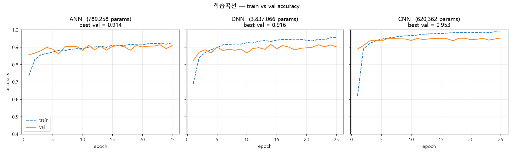

- ANN: 학습·검증 정확도가 0.9 부근에서 함께 움직임
- DNN: 학습 정확도는 0.95까지 오르나 검증 정확도는 0.9 부근에 머묾, 깊이 증가가 검증 성능으로 이어지지 않음
- CNN: 첫 몇 에포크 안에 검증 정확도 0.95 부근 도달 후 유지

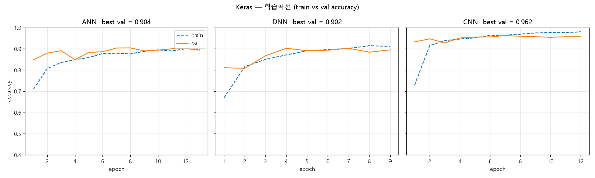

Keras 곡선은 조기 종료가 적용되어 모델마다 에포크 수가 다름. ANN 13, DNN 9, CNN 12 에포크.

### 혼동행렬
어떤 표지판을 어떤 표지판으로 잘못 예측했는지 확인.

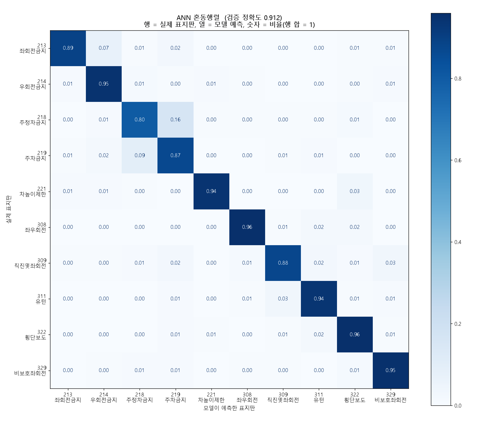

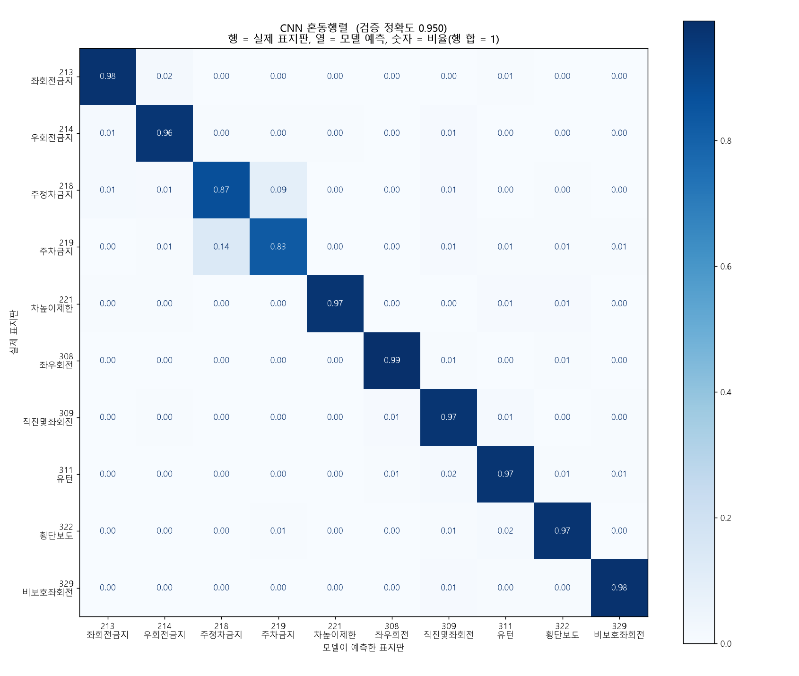

- 가장 큰 혼동은 218 주정차금지와 219 주차금지 사이. 두 표지판은 빨간 테두리와 파란 바탕이 같고 내부 사선·글자만 다름
- PyTorch ANN: 218을 219로 예측한 비율 0.16
- PyTorch CNN: 같은 칸 0.09. 반대 방향인 219를 218로 예측한 비율은 ANN 0.09, CNN 0.14로 이 실행에서는 CNN이 더 높음
- 218·219를 제외한 8개 클래스는 ANN도 대각 값 0.88 이상

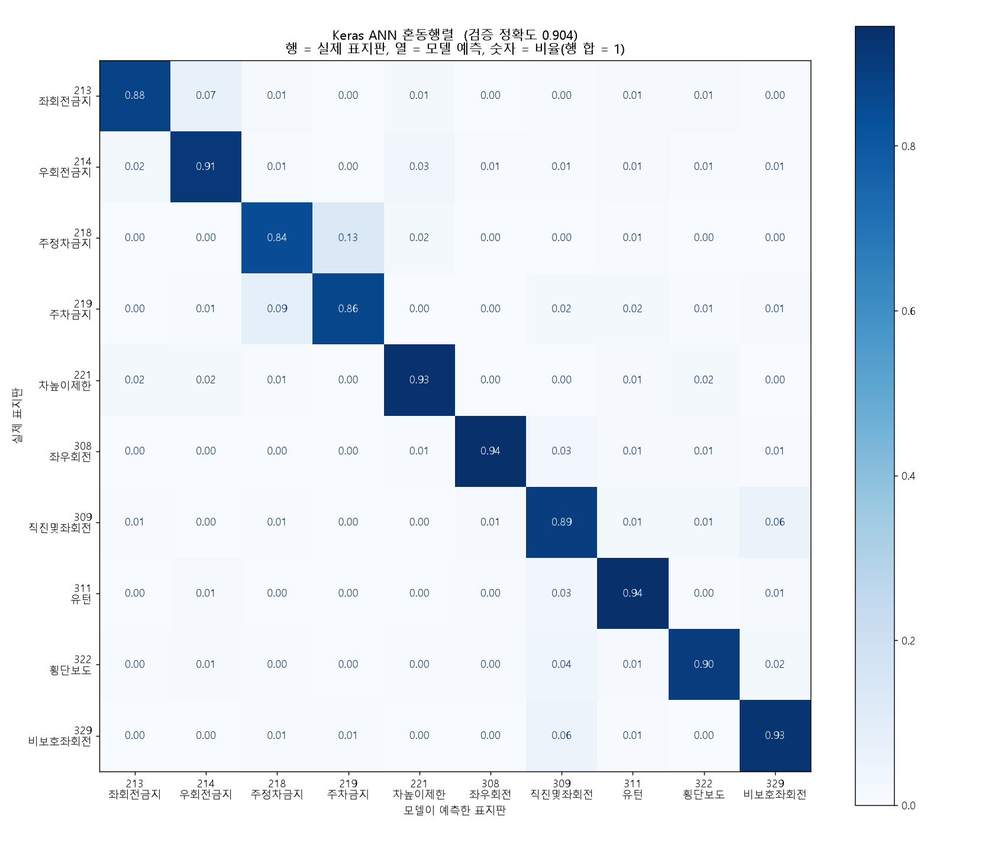

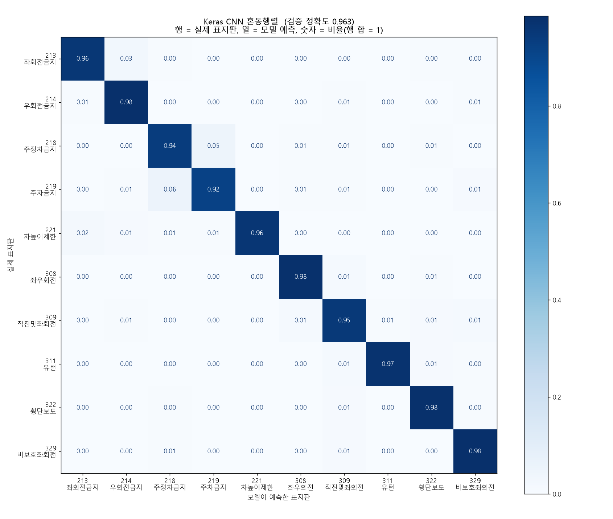

- Keras ANN: 218을 219로 0.13, 219를 218로 0.09
- Keras CNN: 각각 0.05, 0.06으로 감소, 218·219 대각 값 0.94·0.92

### 클래스별 정확도
세 모델의 클래스별 정확도를 나란히 비교. 구조 차이가 어느 클래스에서 크게 나타나는지 확인.

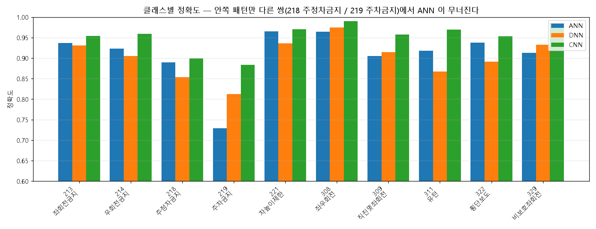

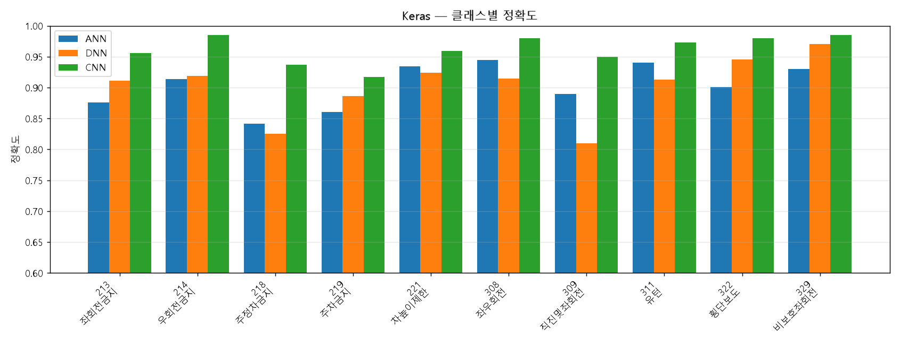

- PyTorch 그림: ANN·DNN 모두 219 주차금지가 최저, ANN 0.73
- Keras 그림: ANN은 218 주정차금지가 최저, DNN은 309 직진및좌회전이 최저이고 218이 그다음
- Keras 그림에서 CNN은 전 클래스 ANN 이상

### 오분류 샘플
`analyze.py`가 ANN은 틀리고 CNN은 맞힌 검증 이미지를 앞에서부터 20장 추출해 격자로 저장.
이미지는 정규화를 되돌려 `x * 0.5 + 0.5`로 표시, 제목에는 앞 6장의 정답과 ANN 예측 표기.

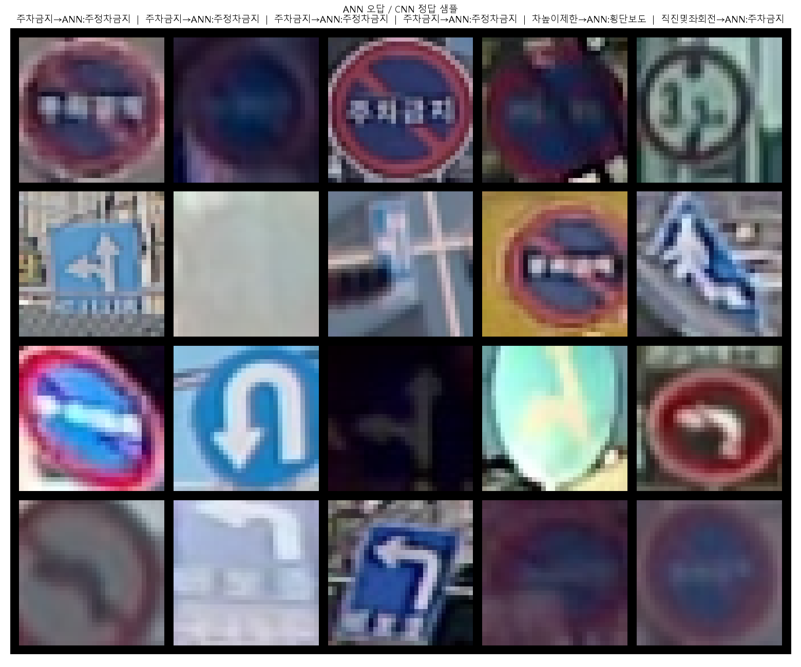

- 앞 4장 모두 219 주차금지를 ANN이 218 주정차금지로 예측한 경우
- 흐리거나 어두운 원형 표지판이 다수

### 입력 크기 실험: `sweep_size.py`
32×32에서 ANN·DNN도 0.90을 내므로, 입력 크기에 따라 구조 간 격차가 달라지는지 확인한 실험.

- 같은 `crop/` 데이터를 16·24·32·48·64px로 리사이즈해 크기마다 데이터 로더 재생성
- 모델은 `build_model` 대신 클래스를 직접 생성. ANN·DNN은 `input_dim = size × size × 3`, CNN은 `image_size = size`로 Flatten 차원 재계산
- 학습 루프·조기 종료·시드 재설정은 `train_torch.py`와 같은 방식, 최대 에포크만 20
- 크기·모델별 파라미터 수, 검증 정확도, 실제 학습 에포크, 소요 시간을 `figs/sweep_size.csv`에 저장, 그림은 `figs/sweep_size.png`

| 입력 | ANN 파라미터 | DNN 파라미터 | CNN 파라미터 |
|---|---|---|---|
| 16px | 199,434 | 1,477,770 | 227,146 |
| 32px | 789,258 | 3,837,066 | 620,362 |
| 64px | 3,148,554 | 13,274,250 | 2,193,226 |

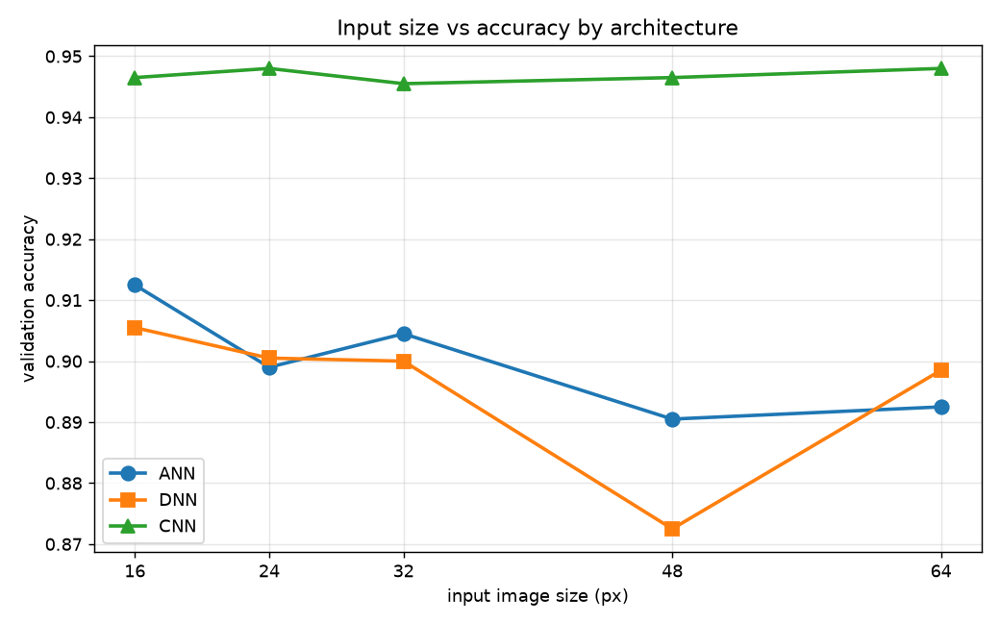

- ANN 64px는 16px 대비 파라미터 약 16배, 정확도는 0.913에서 0.893
- CNN은 모든 크기에서 0.946~0.948

## 한계
- 10종, 종당 1,000장 규모의 소규모 실험
- 모델당 1회 실행, 재실행 시 CNN 정확도 3~5%p 변동
- 깊이·연산 종류·파라미터 수가 동시에 달라 요소별 효과 분리 불가

## 실행

Python 3.11 사용. TensorFlow 휠이 없어 3.13 이상은 설치 불가.
PyTorch GPU 버전은 인덱스를 지정해 설치.

```
pip install torch torchvision --index-url https://download.pytorch.org/whl/cu121
pip install tensorflow pillow matplotlib scikit-learn pandas

python build_dataset.py --src "<AI-Hub 데이터 Training 폴더>"   # crop/<코드>/ 생성
python train_torch.py                # ANN·DNN·CNN 학습, --model cnn 으로 하나만
python train_keras.py
python analyze.py                    # 학습곡선·혼동행렬·클래스별 정확도 → figs/
python analyze_keras.py              # Keras 버전 → figs_keras/
python sweep_size.py                 # 입력 크기별 비교
```

`run_colab.ipynb`: Colab 실행용 노트북.
T4 GPU 런타임에서 저장소 clone, Google Drive의 `crop.zip` 압축 해제, `config.CLASS_NAMES`와 `crop/` 폴더 일치 확인,
`train_torch.py`·`train_keras.py` 실행, ANN·CNN 혼동행렬과 오분류 샘플 확인 순서.

## 파일 구성
```
config.py            클래스·입력 크기·모델 구조 공통 설정
build_dataset.py     상위 10개 코드 crop 데이터 구성
prepare_data.py      초기 방식: AI-Hub 라벨 json에서 표지판 잘라내기
src/torch_impl/      PyTorch ANN·DNN·CNN
src/keras_impl/      Keras ANN·DNN·CNN
train_torch.py       PyTorch 학습 루프 직접 구현
train_keras.py       Keras fit 기반 학습
analyze.py           발표용 그림 생성
analyze_keras.py     Keras 결과 그림
regen_confusion.py   ANN·CNN 혼동행렬 따로 생성
sweep_size.py        입력 크기별 정확도 비교
docs/images/         README 그림
```
